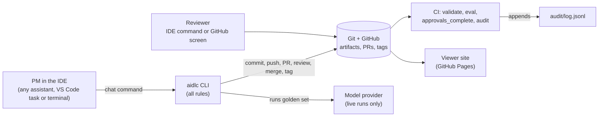

# Architecture

The kit is a Python command-line tool plus a set of generated files. Every rule
lives in the tool; the chat commands, CI and the viewer site are thin layers
over it. Git and GitHub are the only storage.



## Components

| Module | What it does |
|---|---|
| `cli.py` | Entry point. Every command ends with one or two plain sentences: what happened, what is next. |
| `artifacts.py`, `validate.py`, `trace.py` | Reading and writing artifacts, the schema check, parent links and staleness. |
| `config.py`, `reviewers.py` | `aidlc.yaml`: people, review routing, risk tiers. Resolves who must approve what; generates `CODEOWNERS`. |
| `risk.py` | The risk questionnaire and the deterministic tier computation. |
| `workspace.py` | Creating and editing artifacts, the golden set, and the "what next" logic. |
| `gitops.py` | Every Git and `gh` call lives here and nowhere else. Failures become plain-language errors. |
| `review.py` | Submit, approve, reject, mirroring approvals to GitHub reviews, the `approvals_complete` check. |
| `audit.py` | The append-only audit log. |
| `evals/` | The golden-set runner, the cached and live model clients, and one small adapter per model provider. |
| `handoff.py`, `decompose.py` | The handoff gate and package, and the engineer's technical plan. |
| `site/` | The static viewer: a data model, a graph layout and Jinja2 templates. |
| `assistants/` | One neutral source for the chat commands and working rules, rendered per assistant by `aidlc init`. |
| `ci/` | The workflow templates `init` and `sync-ci` write into a repository. |

## Data model

An artifact is a Markdown file with YAML frontmatter. The body is plain
language for people; the frontmatter is what the tool reads.

```yaml
id: REQ-003
type: requirement      # discovery | requirement | criteria | asset | eval | risk
                       #   | privacy_assessment | handoff | decomposition
feature: FEAT-001
title: Route maintenance requests to engineering queue
version: 2             # bumped on every change after the first review
status: approved       # draft | in_review | approved | rejected | stale
owner: alice           # GitHub username
parents: [{id: DISC-001, version: 1}]
approvals: [{by: priya, version: 2, at: 2026-10-29T10:00:00Z}]
```

- **IDs** are sequential per feature and never reused: the audit log is
  consulted so a deleted ID stays taken.
- **Staleness** is computed from direct parents only. If a parent's version is
  higher than the version recorded in `parents`, the item is `stale`.
  `aidlc validate --write` writes the computed status.
- **Approval is for one version.** Editing a reviewed item makes a new version
  and clears its approvals. The approver can never be the owner.
- **Where files live** is fixed per type (`features/FEAT-001-…/requirements/REQ-001.md`,
  `risk.md`, `evals/`, `handoff/HND-001/`, `decomposition/DEC-001.md`).
- **Criteria** carry the thresholds the eval runner checks (`accuracy: 0.9`,
  `max_unsafe: 0`).

Handoff state is not a status. A feature is handed off when the tag
`FEAT-001/handoff-vN` exists, so the record cannot drift from the merge it marks.

## The intake risk step

`/new-feature` asks four plain-language questions (what data the AI sees, what
it does with its output, who is affected, whether it decides anything
regulated) and for a one-line reason, and `risk.py` computes a tier:

- **Tier 3** if payment data is involved, a regulated decision is made, or the
  AI acts on its own with personal or confidential data.
- **Tier 2** if personal or confidential data is involved, the audience is
  customers, or the AI acts after one person approves.
- **Tier 1** otherwise.

The answers are saved as `risk.md` (RISK-001). The author can raise the tier
but not lower it; a lower tier only takes effect when a new version is
approved by the risk reviewer. A tier adds requirements through `aidlc.yaml`:
extra reviewers, required artifacts (a privacy assessment at Tier 3), a minimum
accuracy for every criterion, and whether a human must check the AI output.

## Reviewer routing

`aidlc.yaml` is the single source of truth:

- `people` maps GitHub usernames to roles (`pm`, `ops_reviewer`, `tech_reviewer`,
  `risk_reviewer`, `data_owner`, `engineer`, `kit_admin`, or any role you add).
- `review_routing` says which roles must approve each artifact type.
- `risk_tiers` adds `extra_reviewers` on top for Tier 2 and 3.

A role is satisfied when someone who holds it, and is not the author, has
approved the current version. One approval can satisfy several roles that
person holds. `pm_peer` means any PM other than the author. Types with no
routing need one approval from anyone but the author.

`.github/CODEOWNERS` is generated from the same file by
`aidlc sync-codeowners`; CI fails if it drifts. GitHub itself can only enforce
"1 approval from a code owner", so the role rule is enforced by the
`approvals_complete` check.

## How approvals are trusted

A reviewer approves from the IDE (`/approve`) or on the GitHub pull request
screen. The IDE command writes the approval into the file and submits a
matching GitHub review. A file alone proves nothing, so `approvals_complete`
counts an approval only if GitHub confirms that person approved the PR at a
commit where the item had that version. Roles are read from `aidlc.yaml` on
the base branch, so a pull request cannot grant itself reviewers. Approvals
given on the GitHub screen are written into the files by the PM's next
`/status`, `/reviewers` or `/submit`.

## Evals

The golden set (`evals/golden.yaml`) is recorded as an `eval` artifact holding
its checksum, so reviewers approve exactly the cases that run. The runner
renders the prompt from the asset, asks a model client, parses the JSON
answer, scores it against `expected`, and checks each criterion's thresholds
and the tier's minimums.

- **Cached mode** (CI, and the default) reads saved answers from
  `evals/cache/`. The key covers provider, model, settings, prompt text and
  asset version. A missing answer is an error, not a pass.
- **Live mode** (`/eval --live`) calls the provider named in `aidlc.yaml` and
  saves the answers. It costs money and is never run by CI.

CI also compares a fresh cached run with the committed `report.json`, so a
report that does not match the saved answers is caught.

## Handoff

Handoff is the one hard gate. `gate()` lists every blocker with who can
resolve it. When it is clear, `/handoff` builds a frozen package
(`handoff/HND-001/`: spec, risk, prompts, golden set, eval report, trace,
checksummed manifest) that is itself reviewed, then squash-merges and tags.
CI re-runs the same gate on any package that is current, and verifies the
package files against the manifest.

## CI

| Job | Runs on | Checks |
|---|---|---|
| `validate` | PRs and `main` | Frontmatter, IDs, parent links, staleness, approver is not owner, the handoff gate and package integrity, `CODEOWNERS` drift, and that the audit log was only appended to |
| `eval` | PRs and `main` | Golden sets pass from saved answers; the committed report matches |
| `approvals_complete` | PRs | Every required role approved on the current version, confirmed through GitHub |
| `audit` | merges to `main` | Appends one line per changed item to `audit/log.jsonl` |
| `deploy-site` | merges to `main` | Builds and publishes the viewer |

Audit entries carry `at, feature, id, version, status, actor, approvers, tier,
roles_satisfied, commit, pr`. Pull requests may not touch the log, and the
`validate` job fails if an earlier line was changed or removed.

## The viewer site

`aidlc site build` reads the same functions the CLI uses (the validator, the
gate, role resolution, the eval report, the audit log) and writes plain HTML,
so the site cannot disagree with `/status`. It is built from `main` only.
